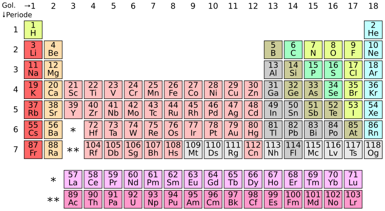

# System Information Platform

Sistem Informasi berbasis web yang dirancang dengan arsitektur modern, performa tinggi, dan skalabilitas tinggi menggunakan ekosistem JavaScript/TypeScript serta PostgreSQL.

## Tabel Periodik



---

## 🛠 Tech Stack

* **Frontend:** Vue.js 3 (Options/Composition API) + Tailwind CSS + Pinia + Vue Router
* **Backend:** Node.js + Express.js
* **Database:** PostgreSQL
* **ORM / Query Builder:** Prisma / Sequelize / Knex.js
* **Authentication:** JWT (JSON Web Token) / HttpOnly Cookies

---

## 🚀 Quick Start

### Prasyarat

* Node.js (v18+)
* PostgreSQL (v14+)
* npm / pnpm / yarn

### 1. Clone Repository

```bash
git clone [https://github.com/username/project-name.git](https://github.com/username/project-name.git)
cd project-name
2. Setup Backend
Bash


cd backend
npm install
cp .env.example .env
# Sesuaikan DATABASE_URL dan JWT_SECRET pada file .env
npm run migrate
npm run dev
3. Setup Frontend
Bash


cd ../frontend
npm install
npm run dev
📁 Struktur Folder Project
Plaintext


├── backend/
│   ├── src/
│   │   ├── config/         # Konfigurasi Database & Env
│   │   ├── controllers/    # Request handler
│   │   ├── middlewares/    # Auth & validation middlewares
│   │   ├── models/         # Schema / Query PostgreSQL
│   │   ├── routes/         # Endpoint API
│   │   └── app.js          # Entry point Express
│   └── package.json
│
├── frontend/
│   ├── src/
│   │   ├── assets/         # CSS, gambar, icons
│   │   ├── components/     # UI Component reusabel
│   │   ├── pages/          # Halaman utama (Views)
│   │   ├── router/         # Vue Router config
│   │   ├── stores/         # Pinia state management
│   │   └── services/       # Axios API client
│   └── package.json
│
└── docs/                   # Dokumentasi Arsitektur & Desain
    ├── ARCHITECTURE.md
    ├── DESIGN.md
    └── SKILLS.md
```
